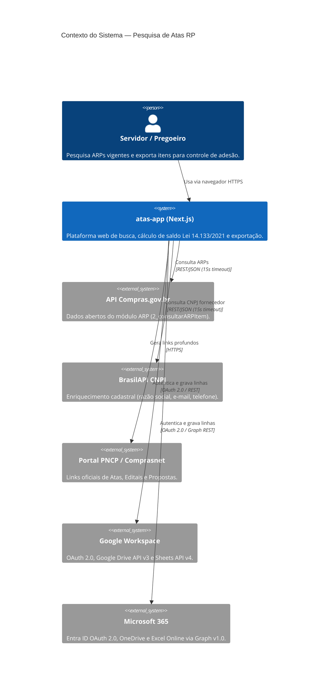
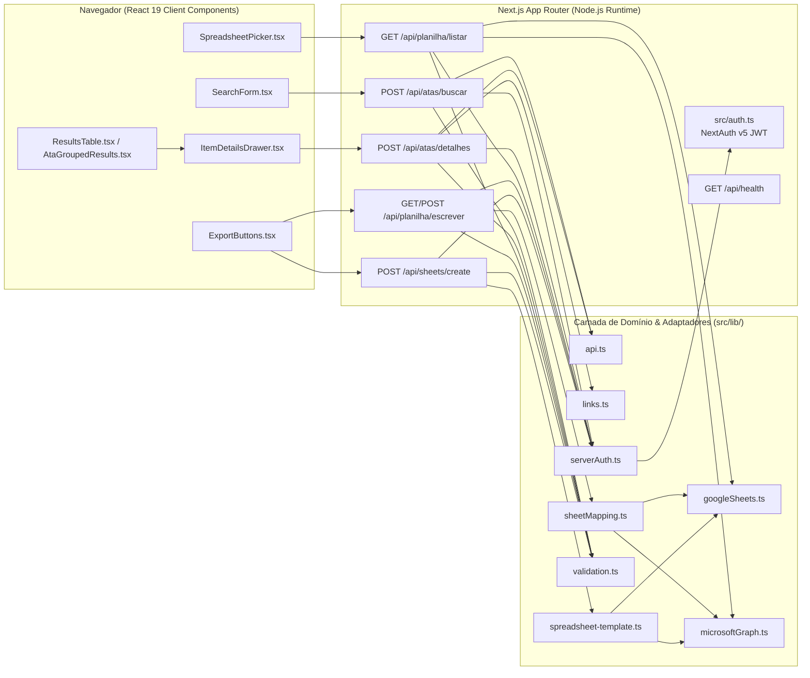

# Arquitetura Técnica — Pesquisa de Atas de Registro de Preços (`atas-app`)

Documento estruturado segundo os modelos **Arc42** e **C4 Model**, alinhado integralmente à base de código em `src/`.

---

## 1. Introdução e Objetivos (Arc42 §1)

O `atas-app` é uma aplicação **Next.js 16 (App Router)** voltada a servidores e equipes de compras públicas brasileiras para localizar, auditar e exportar itens de **Atas de Registro de Preços (ARPs)** compatíveis com adesão ("carona") nos termos da **Lei nº 14.133/2021**.

### Objetivos de Qualidade
| Atributo | Implementação Concreta |
| :--- | :--- |
| **Conformidade Legal** | Cálculo exato de limite individual (50% — Art. 86, § 4º) e teto global (200% — Art. 86, § 5º) em `src/lib/links.ts`. |
| **Segurança na Fronteira** | Autenticação OAuth 2.0 via NextAuth v5 (`src/auth.ts`), token extraído apenas no servidor (`src/lib/serverAuth.ts`), validação estrita Zod (`src/lib/validation.ts`) e neutralização CWE-1236 (`sanitizeSpreadsheetText`). |
| **Confiabilidade** | Timeouts explícitos de `15s` em integrações externas (`axios`/`AbortSignal.timeout`), `runtime = 'nodejs'` e `maxDuration = 60` nos Route Handlers. |
| **Interoperabilidade** | Planilha padrão gerada em memória (`src/lib/spreadsheet-template.ts`) com fórmulas em inglês compatíveis com Google Sheets e Excel Online. |

---

## 2. Diagrama de Contexto (C4 Level 1)

---

## 3. Visão de Contêineres e Fluxo de Dados (C4 Level 2)

---

## 4. Componentes e Contratos Internos (C4 Level 3)

### 4.1 Camada de Domínio (`src/lib/` & `src/types/`)

| Arquivo | Responsabilidade Principal | Símbolos-Chave |
| :--- | :--- | :--- |
| `src/types/index.ts` | Contratos de domínio, filtros e layouts de planilha | `ARPItem`, `SaldoAdesao`, `SheetRowConsumo`, `SheetRowPermanente`, `SheetRowContrato`, `SheetType` |
| `src/lib/links.ts` | Regras da Lei 14.133/2021, parsers PNCP/Comprasnet, BrasilAPI | `calcularSaldoAdesao`, `enrichWithSaldoAdesao`, `convertToPncpAtaLink`, `convertToPncpEditalLink`, `convertToPropostaItemLink`, `fetchFornecedorContato`, `safeHttpsUrl` |
| `src/lib/api.ts` | Cliente HTTP Compras.gov.br e normalização para `ARPItem` | `fetchARPItems`, `fetchARPItemDetails`, `fetchAdesoesCaronas`, `getDefaultDateRange` |
| `src/lib/sheetMapping.ts` | Mapeamento por tipo de aba e sanitização anti-injeção | `sanitizeSpreadsheetText`, `mapToConsumoRow`, `mapToPermanenteRow`, `mapToContratoRow`, `getSheetMapper` |
| `src/lib/spreadsheet-template.ts` | Workbook institucional padrão `.xlsx` com 4 abas | `buildStandardWorkbook`, `generateStandardWorkbookBuffer`, `getStandardSheetNames` |
| `src/lib/googleSheets.ts` | Adaptador Google Drive v3 e Google Sheets v4 | `listUserSpreadsheets`, `getSpreadsheetSheets`, `appendRowsToSheet` |
| `src/lib/microsoftGraph.ts` | Adaptador OneDrive/SharePoint e Excel Online Graph v1.0 | `listUserSpreadsheets`, `getSpreadsheetSheets`, `appendRowsToExcel` |
| `src/lib/excelExport.ts` | Exportação local no navegador via SheetJS (`xlsx`) | `exportToExcel`, `downloadExcel` |
| `src/lib/validation.ts` | Schemas Zod fail-closed para todos os endpoints | `searchSchema`, `detailSchema`, `spreadsheetQuerySchema`, `spreadsheetWriteSchema`, `createSpreadsheetSchema` |
| `src/lib/serverAuth.ts` | Extração server-side do OAuth access token via JWT | `getServerAccessToken` |

### 4.2 Contratos HTTP das API Routes (`src/app/api/`)

| Rota | Método | Auth | Validação Zod | Retorno `200 OK` |
| :--- | :--- | :--- | :--- | :--- |
| `/api/health` | `GET` | Pública | — | `{ status, service, timestamp, version }` |
| `/api/auth/[...nextauth]` | `GET`/`POST` | NextAuth | — | Fluxo OAuth / sessão JWT |
| `/api/atas/buscar` | `POST` | JWT | `searchSchema` | `{ items: ARPItem[], total: number }` |
| `/api/atas/detalhes` | `POST` | JWT | `detailSchema` | `{ item: ARPItem }` (enriquecido) |
| `/api/planilha/listar` | `GET` | JWT | `providerSchema` | `{ spreadsheets: ConnectedSpreadsheet[] }` |
| `/api/planilha/escrever` | `GET` | JWT | `spreadsheetQuerySchema` | `{ sheets: string[] }` |
| `/api/planilha/escrever` | `POST` | JWT | `spreadsheetWriteSchema` | `{ success, updatedRows?, error? }` |
| `/api/sheets/create` | `POST` | JWT | `createSpreadsheetSchema` | `{ success, provider, spreadsheetId, webViewLink, sheets }` |

---

## 5. Regras de Negócio — Lei nº 14.133/2021 (Arc42 §8)

1. **Limite por Órgão Carona (Art. 86, § 4º)**:
   $$\text{limiteOrgaoCarona} = \lfloor \text{quantidadeHomologada} / 2 \rfloor$$
2. **Teto Global de Adesões (Art. 86, § 5º)**:
   $$\text{saldoGlobalRestante} = (2 \times \text{quantidadeHomologada}) - \text{quantidadeAutorizada}$$
3. **Saldo Efetivo Disponível**:
   $$\text{saldoDisponivelOrgao} = \min(\text{limiteOrgaoCarona},\; \text{saldoGlobalRestante})$$
4. **Indicador Semafórico (`SaldoAdesao.indicador`)**:
   - `'vencido'`: `dataVigenciaFinal < hoje (00:00:00)` (sobrepõe os demais estados em `enrichWithSaldoAdesao`).
   - `'esgotado'`: `saldoDisponivelOrgao <= 0`.
   - `'reduzido'`: `0 < saldoDisponivelOrgao <= limiteOrgaoCarona * 0.2`.
   - `'disponivel'`: caso contrário.

---

## 6. Decisões Arquiteturais (ADRs)

- **ADR-01 — Token OAuth restrito ao JWT server-side**: `src/auth.ts` omite `accessToken` e `refreshToken` do callback `session()`, expondo-os apenas no JWT HTTP-only lido por `getServerAccessToken()`. Evita exposição de tokens Google/Microsoft em código client-side.
- **ADR-02 — Sanitização CWE-1236 antes do `USER_ENTERED`**: `sanitizeSpreadsheetText()` prefixa `'` em strings iniciadas por `=`, `+`, `-`, `@`, `\t`, `\r`, mantendo `USER_ENTERED` seguro para números e datas sem permitir execução de fórmulas maliciosas.
- **ADR-03 — Fórmulas em inglês no template `.xlsx`**: `buildStandardWorkbook()` grava `COUNTA`, `COUNTIF`, `COUNTIFS`, `SUM` e `TODAY()` em inglês (padrão OpenXML), garantindo cálculo nativo no Google Sheets e Excel Online.
- **ADR-04 — Placeholder explícito para adesões externas**: `fetchAdesoesCaronas()` em `src/lib/api.ts` retorna `0` até integração futura com `/modulo-arp/5_consultarAdesoesItem`, mantendo o cálculo determinístico e testável.

---

## 7. Verificação Automatizada

- **Testes Unitários**: `npm test` executa `tests/business-rules.test.ts` via Vitest (cálculo de saldos Lei 14.133/2021, parsers de links PNCP/Comprasnet, mapeamento das 3 abas e sanitização contra formula injection).
- **Build & Tipagem**: `npm run build` valida compilação TypeScript estrita e geração de rotas App Router/Turbopack.
